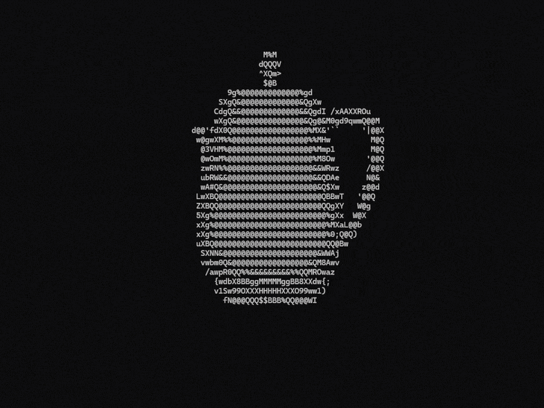

# rview

<div align="center">
  
  

A software rasterizer written in Rust that renders shaded 3D models directly in your terminal using solid block characters.
</div>

## Features

- Perspective projection and triangle rasterization
- Optional high-resolution, shaded desktop viewer (`--gui`)
- Turntable animation mode with configurable speed
- Built-in benchmark mode for performance profiling
- Multi-format model loading: `.obj`, `.gltf`, `.glb`, `.stl`

## Usage

```bash
cargo run --release -- [OPTIONS] <FILE_PATH> [COMMAND]
```

For a higher-resolution desktop viewer instead of the terminal view:

```bash
cargo run --release -- --gui <FILE_PATH>
```

For more information run:

```bash
cargo run --release -- -h
```

### Modes

| Mode | Description | Example |
|---|---|---|
| `interactive` | Control the camera manually (default) | `rview model.obj interactive` |
| `turntable` | Automatically rotate the model | `rview model.obj turntable --speed 2.0` |
| `benchmark` | Run a fixed animation and exit | `rview model.obj --bench` |

### Controls *(interactive mode)*

| Control | Action |
|---|---|
| Mouse drag | Rotate camera |
| Arrow keys | Rotate camera |
| Scroll up/down | Zoom in/out |
| `q` | Quit |

In the desktop viewer, drag with the left mouse button or use the arrow keys to rotate,
scroll to zoom, and press `Esc` or `q` to close.

## Supported Formats

| Format | Extension |
|---|---|
| Wavefront OBJ | `.obj` |
| GL Transmission Format | `.gltf`, `.glb` |
| Stereolithography | `.stl` |

## Build With

- [`rust`](https://rust-lang.org/): Language
- [`crossterm`](https://github.com/crossterm-rs/crossterm): cross-platform terminal manipulation
- [`glam`](https://github.com/bitshifter/glam-rs): SIMD-accelerated linear algebra
- [`tobj`](https://github.com/Twinklebear/tobj): fast `.obj` file parsing
- [`gltf`](https://github.com/gltf-rs/gltf): `.gltf` and `.glb` file parsing
- [`stl_io`](https://github.com/hmeyer/stl_io): `.stl` file parsing
- [`minifb`](https://github.com/emoon/rust_minifb): lightweight desktop model viewer
- [`clap`](https://github.com/clap-rs/clap): command-line argument parsing
- [`anyhow`](https://github.com/dtolnay/anyhow): ergonomic error handling
- [`rayon`](https://github.com/rayon-rs/rayon): data-parallel processing

## AI Disclosure

This project was developed with the assistance of Claude Sonnet 4.6 (Anthropic) for code review, optimization, and design decisions. All code was written, tested, and validated by the author.

## Assets

- **Suzanne**: [Blender](https://en.wikipedia.org/wiki/Blender_(software)#Suzanne)
- **Modified Utah Teapot** (2025 revision by Cem Yuksel): [University of Utah](https://graphics.cs.utah.edu/teapot/).
  A historic 3D model developed at the University of Utah, used in accordance with their [terms of use](https://graphics.cs.utah.edu/teapot/).

## License

This project is licensed under the GNU GPLv3 License - see the [COPYING.md](COPYING.md) file for details
